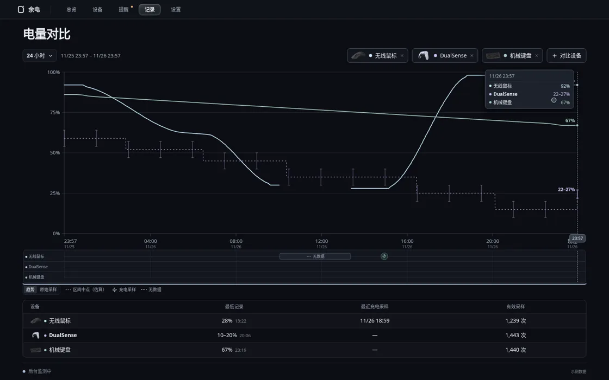

# 余电 PowerManager

余电监测鼠标、键盘、手柄和耳机的剩余电量，快没电时发提醒。关闭主窗口后，仍会在 Windows 托盘里运行。

[下载最新版](https://github.com/Captivate-Shi/PowerManager/releases/latest) · [设备支持列表](docs/device-compatibility-ledger.md) · [演示视频](https://raw.githubusercontent.com/Captivate-Shi/PowerManager/main/docs/media/powermanager-demo.mp4)

## 下载与安装

Windows 10 / 11（x64）。发布页提供两种下载：

| 文件 | 用法 |
| --- | --- |
| `PowerManager-Setup-<版本>.exe` | 安装版。可选安装目录和桌面快捷方式；缺少 WebView2 时由安装器处理。 |
| `PowerManager-<版本>-win-x64.zip` | 免安装版。完整解压后运行 `PowerManager.exe`；电脑需已安装 WebView2。换包前先退出托盘里的旧实例。 |

从 0.2.0 升级可以覆盖安装，设置和电量记录保留。安装版与免安装版使用同一份本机数据。

## 功能

- **总览**：在展台和列表间切换，查看电量、连接、充电状态与最近更新时间。单击托盘图标打开快览，双击打开主窗口。
- **设备**：看单台外设的电量趋势，设专属低电量阈值，复制设备信息。
- **提醒**：多台告急合并为一张卡，设备开始充电就从卡片移除。告急弹窗可定时关闭或一直显示；桌面弹窗、桌面提示音和全屏提示音分别设置。
- **记录**：同时比较最多三台，区分充电、断连和无数据时段；记住上次选择和配色。
- **设置**：轮询可选 30 秒、1 分钟、5 分钟和 10 分钟，默认 1 分钟。可调整记录保留时间、主题、缩放和登录自启。

## 支持的外设

| 类型 | 已接入的代表型号 |
| --- | --- |
| 手柄 | DualSense、DualSense Edge、DualShock 4 v1 / v2（USB、蓝牙） |
| 鼠标 | Logitech G502 LIGHTSPEED、PRO X SUPERLIGHT 初代、MX Master 3S（Bolt）；Razer Viper V3 HyperSpeed（2.4 GHz） |
| 键盘 | Razer BlackWidow V4 Low-profile TKL HyperSpeed（指定共享接收器）、VGN V98 Pro V3（USB、原装接收器） |
| 耳机 | Sony WH-1000XM4、OPPO Enco X3（匹配的蓝牙通道）；也可读取支持标准电量服务、或已经向 Windows 上报电量的耳机 |

同一型号用蓝牙、USB 和接收器时，电量支持可能不同。[完整型号、连接方式与验证情况](docs/device-compatibility-ledger.md)

## 性能

WebView2 版不再随应用分发浏览器运行库。关掉主窗口后会释放渲染进程，托盘和采集继续运行。

| 场景 | Windows 实测（WebView2 RC10） |
| --- | ---: |
| 主窗口空闲 | CPU 0.081% · 私有工作集 116 MiB |
| 关闭主窗口，后台监测 | CPU 约 0.003% · 私有工作集 9 MiB |
| 冷启动到主窗口显示 | 0.74–1.30 秒 |
| 单击托盘到快览显示 | 中位数 414 毫秒 |
| 切换页面 | P95 23 毫秒 |

[测试版本与测量口径](docs/webview2-performance.md)

## 设备反馈

电量读不到或读错了，在「设置 → 诊断 → 生成兼容性报告」选中设备、预览并保存，到 [GitHub Issues](https://github.com/Captivate-Shi/PowerManager/issues)附上报告和连接方式。报告不会自动发出。
