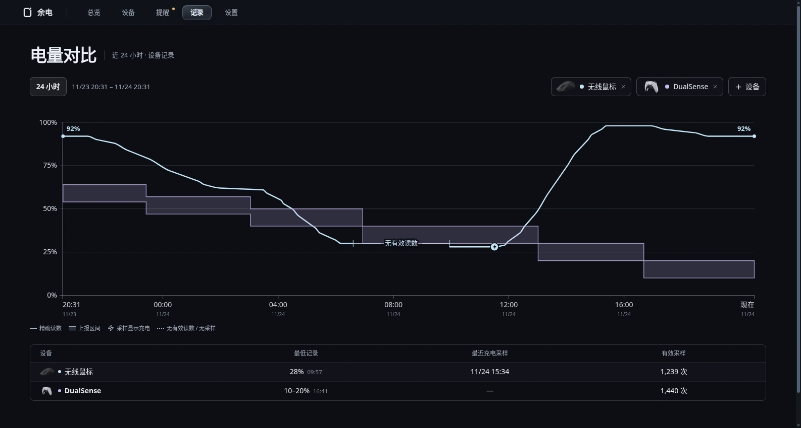

# 余电 PowerManager

## 功能背景

打游戏或开会时，手柄、鼠标、键盘突然没电，往往来不及换。余电是一款 **Windows 11 x64 外设电量管理器**，把兼容设备的电量放在同一个界面。关闭主窗口后仍在托盘监测，电量低了再提醒。

## 功能介绍

- **设备与电量**：查看电量、连接状态、读数来源与时间。支持读取部分 Razer 接收器及 DualSense；其他设备可先在 Windows 配对，再到「设备 → 查找设备」尝试添加。设备只上报档位时显示区间，没有有效读数时显示「—」。[支持范围与读数说明](COMPATIBILITY.md)
- **总览与托盘**：主界面可在展台和列表之间切换。主窗口收起后，单击托盘图标查看电量，双击打开主界面。打开主界面时会收起托盘面板。
- **低电量提醒**：区分低电量和紧急两级，支持全局阈值、单设备阈值及静音。可配置桌面弹窗或全屏时仅播放提示音，减少对游戏和会议的打扰。
- **电量记录**：保留近 24 小时记录，最多对比 3 台设备。图表区分百分比、设备上报区间、采样时的充电状态和没有有效读数的时段。记录及设置保存在本机。

## 产品截图

**总览 · Windows 11 实机**

设备未返回有效电量时，界面显示「—」。

**电量记录 · 实际界面，模拟数据**

展示 24 小时对比里的百分比曲线、设备上报区间和读数缺口。

**托盘快览 · 实际界面，模拟数据**

紧急设备置顶；连接待确认时，明确标注为上次记录。

## 产品性能

下表为 **1.6.1 评审构建**在一台 Windows 11 x64（24 个逻辑处理器）设备上的测量结果。每种状态静置采样约 53 秒，统计整个应用进程树，包含原生采集器；CPU 按整机逻辑核数归一。

| 测试状态 | 平均 CPU 占用 | 平均工作集 | 平均私有内存 |
| --- | ---: | ---: | ---: |
| 主窗口可见，静置 | 0.0185% | 389.2 MiB | 351.9 MiB |
| 收起约 25 秒后，主界面已释放，仅后台监测 | 0.0062% | 293.4 MiB | 282.3 MiB |

主窗口释放前后，重新打开至窗口可见分别约为 **127 ms** 和 **235 ms**。后台 60 秒观测到 39 次巡检，未记录巡检失败；这只说明采集循环持续运行，两台实测雷蛇外设均未回传电量。以上不是其他设备的性能保证，未单独测量托盘面板打开时的占用。[测试与诊断说明](qa/README.md)
