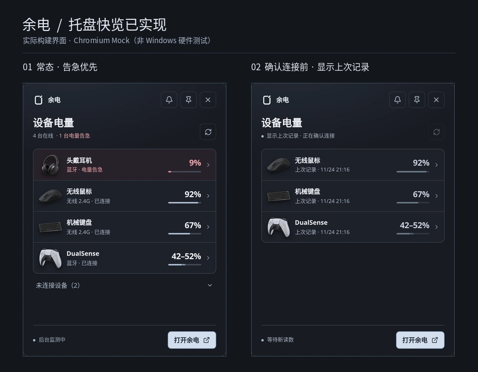

# 余电 PowerManager

## 功能背景

打游戏或开会时，外设没电往往来不及换。余电在 Windows 11 x64 上监测外设电量，关掉主窗口后仍在托盘运行。当前版本：**0.0.1 内测版**。

## 功能介绍

- **设备与电量**：查看电量、连接状态和读数时间。支持部分 Razer 接收器及 DualSense。其他设备配对后，可在「设备 → 查找设备」尝试添加。[ⓘ 适配范围与读数](COMPATIBILITY.md)
- **总览与托盘**：展台和列表随时切换。主窗口收起后，单击托盘图标查看电量，双击打开主窗口。
- **低电量提醒**：设置全局或单设备阈值，区分低电量和紧急提醒。可静音，或在全屏时只播放提示音。
- **电量记录**：对比最多 3 台设备，支持 24 小时、7 天、30 天和 365 天。近 24 小时显示明细，更长范围显示每日最低读数。本机保存记录和查看范围。

## 产品截图

**总览 · Windows 实机（版本重置前）**

**电量记录 · 模拟数据**

**托盘快览 · 模拟数据**

## 产品性能

| 测试状态（1.6.1 实测） | 平均 CPU | 平均工作集 | 平均私有内存 |
| --- | ---: | ---: | ---: |
| 主窗口可见，静置 | 0.0185% | 389.2 MiB | 351.9 MiB |
| 主窗口释放后，仅后台监测 | 0.0062% | 293.4 MiB | 282.3 MiB |

重新打开主窗口：释放前约 **127 ms**，释放后约 **235 ms**。

---

ⓘ 测试说明 · 更新于 2026-11-24

数据来自版本归零前的 [1.6.1 评审构建](https://github.com/Captivate-Shi/PowerManager/commit/d22a86ad652536674156312448cd8d20ee962d0b)，未在 0.0.1 上复测。Windows 11 x64，24 个逻辑处理器，每种状态静置采样约 53 秒；统计含原生采集器的应用进程树，CPU 按整机核数归一。托盘快览打开时的占用未单测。[测试与诊断](qa/README.md)

