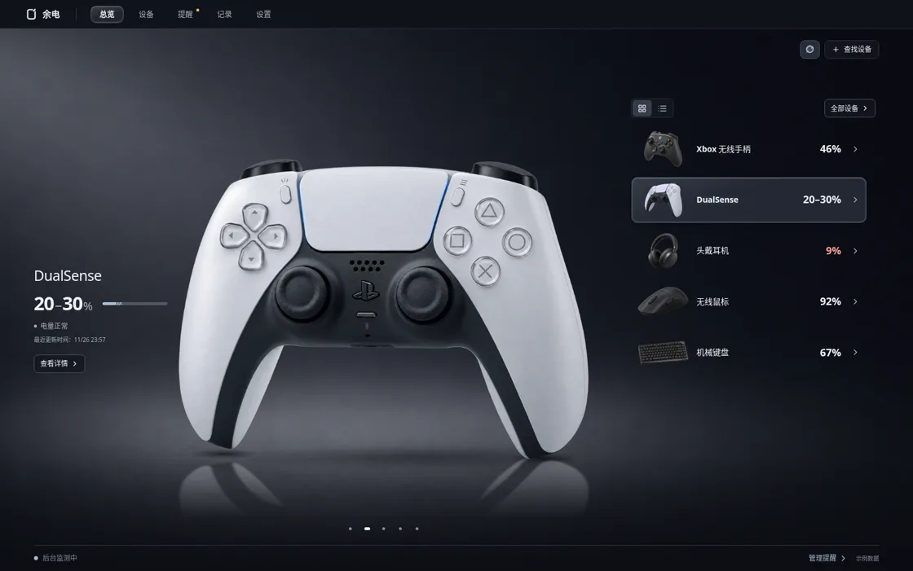

# 余电 PowerManager

余电在 Windows 托盘里监测外设电量。打游戏或开会时，手柄、鼠标、键盘和无线耳机快没电了，不用等断开才发现。

[下载最新版](https://github.com/Captivate-Shi/PowerManager/releases/latest) · [查看支持设备](COMPATIBILITY.md)

[播放操作演示（MP4，示例数据）](https://raw.githubusercontent.com/Captivate-Shi/PowerManager/main/docs/media/powermanager-demo.mp4)

## 安装

1. 在发布页下载 `PowerManager-Setup-<版本>.exe`。适用于 Windows x64。
2. 选择安装位置。默认是 `%LOCALAPPDATA%\Programs\PowerManager`，可选创建桌面快捷方式。
3. 安装完成后，可以勾选「立即启动 PowerManager」。关闭主窗口后，余电继续在托盘监测。

从 Electron 或早期 WebView2 测试版升级时，先从 Windows 设置卸载旧版。卸载 WebView2 测试版不会删除设置和电量历史，新版会沿用它们。首次安装时，如果电脑没有 WebView2 运行库，安装器会从微软下载。

## 功能

- **总览**：展台或列表查看连接状态、电量和最近更新时间。托盘单击打开快览，双击打开主窗口。
- **设备**：查看单个外设的读数和趋势。读数按设备上报显示百分比或区间；断开时不会把上次读数当成实时电量。
- **提醒**：自定义低电量阈值。桌面弹窗、桌面提示音和全屏提示音可以单独开关。
- **记录**：同图比较最多三台设备，查看电量曲线、充电采样和无数据时段。记录保存在本机，保留期限可调。
- **设置**：调整主题、界面缩放、采集与存储选项，按需开启登录自启。

## 包体和后台占用

0.2.0 使用系统 WebView2，不再随安装包分发 Electron。x64 安装包约 7 MB，不含系统 WebView2 运行库。关闭主窗口后，渲染窗口会释放，托盘和设备采集继续运行。

## 设备反馈

在「设置 → 诊断 → 生成兼容性报告」选择外设，找不到型号时可手动填写。预览后保存，再附到 [GitHub Issues](https://github.com/Captivate-Shi/PowerManager/issues)，注明连接方式和现象。报告不会自动发送。
